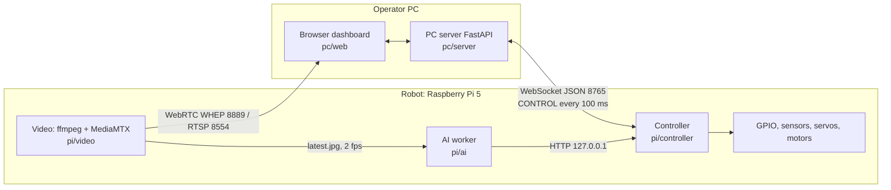

# Architecture

Summary of how Kashimo is built. Exact message fields, config keys, pins and constants: [design.md](design.md) section 4 (frozen contracts). If this file and design.md disagree, design.md wins.
Tags: **[BUILT]** code exists and is tested on a PC. **[STUB]** file exists, no logic. **[PLANNED]** not started.

## 1. System

| Block | Role | Status |
|---|---|---|
| `pc/web` | Dashboard: keys, readouts, banners, video, photo, screenshot | [BUILT] K13, K14. Map and log panel [BUILT] K15 |
| `pc/server` | Serves the page, relays WebSocket, saves photos, screenshots, CSV | [BUILT] K12 |
| `common/` | Message validation, constants, key map shared by PC and Pi | [BUILT] K02 |
| `pi/video` | One ffmpeg: H.264 to MediaMTX, 2 fps JPEG for the AI, 60 s recording segments | [BUILT] K10, never run on the Pi |
| `pi/controller` | `hw`, `sensors`, `drive`, `head`, `rod`, `imu`, `position` | [BUILT] K04-K08, fake hardware only |
| `pi/controller` | `main` loop, `ws_server`, `telemetry`, `events`, watchdog wiring | [BUILT] K09, mock hardware only |
| `pi/ai` | Detector interface, dummy, ONNX loader, 3-in-a-row rule, worker | [STUB on main] K11 in progress |
| `tools/fake_pi.py` | Stands in for the Pi so the PC side runs with no robot | [BUILT] K03 |

## 2. Data flows
- **Control:** key held, browser sends CONTROL (drive, head) every 100 ms. This is also the heartbeat. No valid message for 500 ms and the Pi stops the motors and sets the latch. One-shot commands (LED, ROD, STOP, HEAD_HOME) use CMD.
- **Telemetry:** Pi sends TELEMETRY at 10 Hz (state, distances, position, slab, rod, IMU, link, CPU, AI status) and EVENT messages (alerts, link lost/back). After a reconnect the PC sends SYNC and the Pi replays missed events.
- **Video:** camera (USB, MJPEG) to ffmpeg to MediaMTX. The browser plays WebRTC (WHEP) or MJPEG fallback. The AI reads a JPEG file, never the H.264 stream.
- **AI:** scores a frame only when LED is on and rod and head are still. Three flagged frames in a row give an ALERT_DEFECT with frame and heatmap. The operator judges.
- **Evidence:** Enter saves a photo, P a screenshot, on the PC, with slab and distance in a CSV.

## 3. Rules the code relies on
- Manual driving only. Nothing moves unless a key is held.
- Safe state in hardware: motor enable pins pulled down. Crashed or booting Pi means motors off.
- Everything runs on a PC with `HW_MODE=mock`. Code that needs the real Pi is marked `# CHECK ON PI`.
- The AI is a plug-in: `config.yaml` selects `dummy` or `onnx`. Dummy output is labelled as test data in the dashboard. A missing model shows "no model loaded" and never falls back to the dummy.
- No framework, build step or CDN in the dashboard: it works offline.

## 4. Repository map
| Folder | Content |
|---|---|
| `common/` `pi/` `pc/` `tools/` `tests/` `config/` `systemd/` | Code and its tests |
| `hardware/` | BOM, pin map, power. No CAD yet |
| `results/` | Measured results, one file per test run |
| `ai/` | AI data, training notes, model card. Model files are not in Git |
| `media/` | Photos, diagrams, videos (small files only) |
| `docs/` | Design, manual, phase 1 and 2 material, task cards |

## 5. Known limits
See [design.md](design.md) section 10 (open questions) and 11 (suggestions). Main ones: position error expected about plus or minus 2 slabs [EST], Pi 5 CPU shared by video, AI and software PWM, water plus live cables is a safety question for ACTIA.
