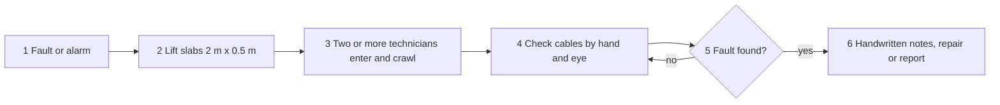
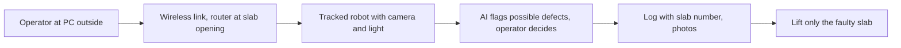

# Phase 2 material

Source of this page: the phase 1 poster ([../phase1](../phase1/)). It is copied here as Markdown so it can be edited and linked. Nothing new is claimed. The 5-7 page technical report goes in this folder as `report.md` or `report.pdf` (not written yet).

## AS-IS process (today, ACTIA estimates)

| Bottleneck | Step | Problem |
|---|---|---|
| B1 | 2 | Slab lifting and entry preparation delay every visit |
| B2 | 3 | Crawling in a dark space 1.5 m deep |
| B3 | 4 | Hand check next to live 380 V cables is unsafe |
| B4 | 6 | Handwritten notes, no defect record or location |

## TO-BE process (target)

Steps 3 and 4 become a robot survey through one opened slab. Removes B2 to B4, reduces B1. This is a design intent, not a measured result.

## State of the art (from the poster)
| Type | Finding | Ref |
|---|---|---|
| Literature | Tracked robots with cameras and sensors inspect cable trenches. EMI in substation trenches needed dedicated WLAN links | [1], [2] |
| Standards | IEC 61000-6-2 (EMC immunity), OSHA 29 CFR 1910.146 (confined spaces). No standard yet for tracked units (draft PNW 129-56) | [4], [5], [6] |
| Patent | Trench robot that raises its camera to see bundled cables | [7] |
| Industry | Utility operators use tunnel robots (quadrupeds). No low-cost unit found for a slab-covered gallery | [8] |
References are listed in full on the poster.

## Alternatives and decision
| Criterion | Weight | A Tracked robot | B Ride-on carrier | C Quadruped |
|---|---|---|---|---|
| Technical performance | 20 % | 4 | 3 | 4 |
| Cost (at most 750 TND) | 30 % | 5 | 2 | 1 |
| Feasibility, complexity | 20 % | 5 | 2 | 2 |
| Reliability, safety | 20 % | 4 | 1 | 3 |
| Sustainability, scalability | 10 % | 4 | 2 | 3 |
| **Weighted score** | 100 % | **4.5** | **2.0** | **2.4** |
Scores are the team's judgement from phase 1, not measurements. Selected: A. Trade-offs: debris, radio link.

## AI method comparison (planned)
Design.md section 6.2 compares anomaly detection (PatchCore, EfficientAD) and the YOLO model trained by the team's AI member. Benchmarks on the Pi are not done. Status: [../ai/README.md](../../ai/README.md).

## Still to write for the report
PoC description (what runs today: PC software with fake Pi), validation plan ([../TESTING.md](../TESTING.md)), measured results, impact ([../IMPACT.md](../IMPACT.md)).
